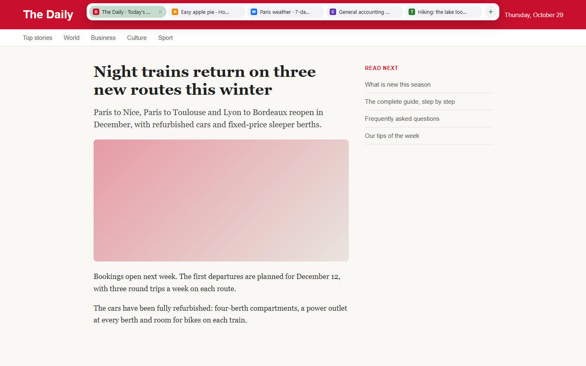
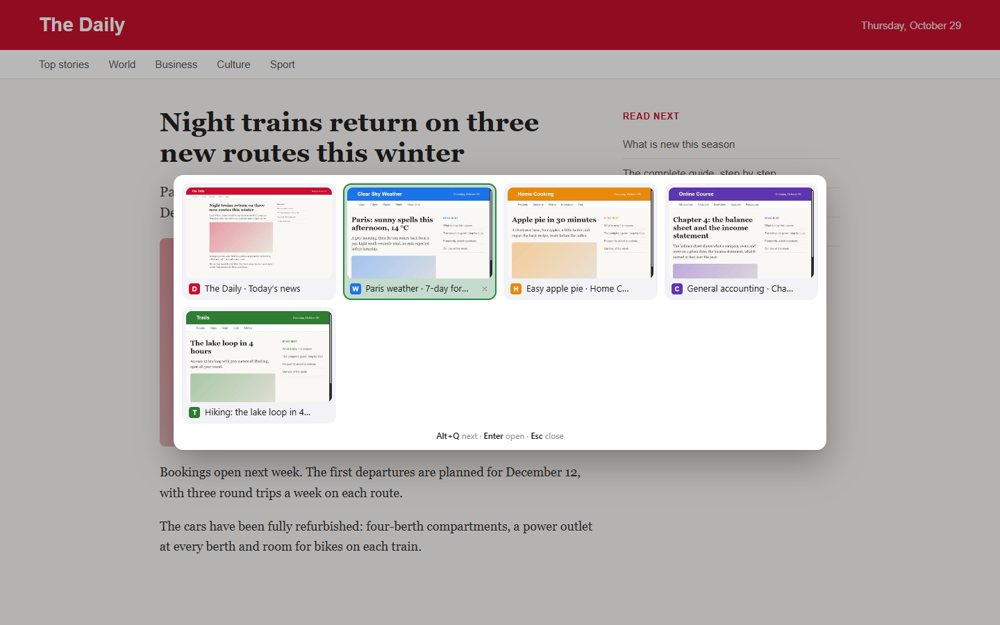
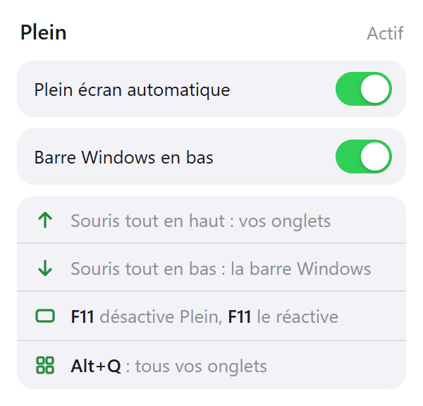
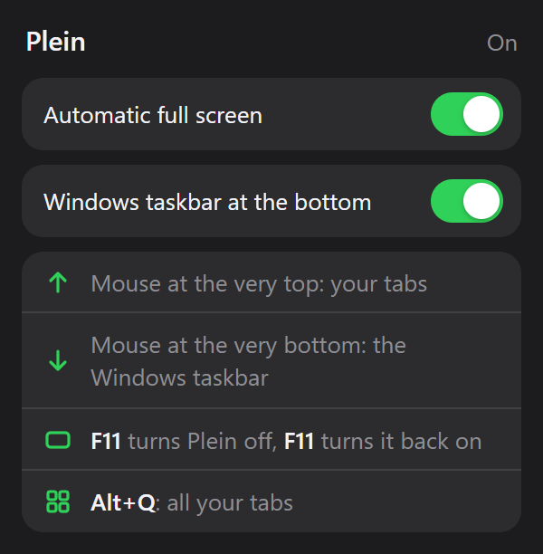

# Plein

A Chrome extension that keeps websites in full screen, with the edges of the screen doing the work of the hidden toolbars: move the mouse to the top to see your tabs, to the bottom to get the Windows taskbar, and press `Alt+Q` for a grid of every tab with a preview.

## What it does

- **Websites stay in full screen.** Opening or switching to a website puts the window in full screen by itself, like pressing `F11`. Chrome's own pages (new tab, settings, extensions), error pages and PDFs stay in a normal window, with the real tabs and the address bar, because nothing can be drawn on them.
- **The top edge shows your tabs.** Touching the top of the screen slides down a bar with the tabs of the window: a click opens one, the cross or a middle click closes it, the **+** opens a new tab.
- **The bottom edge shows the Windows taskbar.** A short pause at the bottom of the screen takes the window out of full screen so the taskbar appears. Moving back up into the page, or coming back to Chrome from another application, puts it in full screen again. A brief blur hides the jump while Windows resizes the window.
- **`Alt+Q` shows every tab.** Like `Alt+Tab` in Windows: hold `Alt` and press `Q` to move from tab to tab, release `Alt` to open the one selected. A quick `Alt+Q` keeps the grid open, to choose with the arrows, `Enter` or the mouse. Tabs of all windows are there, the most recently seen first, each with a preview of the page as it was last seen.
- **`F11` is the switch.** Leaving full screen by hand (`F11` or Chrome's menu) turns Plein off and brings back a maximized window, not the slightly smaller one Chrome restores. Entering full screen by hand turns it back on.

 

The interface follows the language of Chrome: English by default, and also French, Spanish, Brazilian Portuguese, German, Italian, Russian, Turkish, Arabic, Japanese, Korean and Simplified Chinese. The websites in the screenshots are made up for the demonstration.

## Install

The extension is not on the Chrome Web Store, so it is loaded by hand:

1. Download this repository (**Code**, then **Download ZIP**) and unzip it, or clone it.
2. Open `chrome://extensions` and turn on **Developer mode**.
3. Click **Load unpacked** and choose the folder.
4. Check the shortcut at `chrome://extensions/shortcuts`: **See all tabs** should read `Alt+Q`. If Chrome left it empty, click the pencil and press `Alt+Q`.

## How it works, and what that means

- **Chrome cannot show its tabs over a full-screen window on Windows**, unlike on a Mac. The bar at the top is Plein's own, drawn in the page.
- **Windows hides its taskbar over full-screen windows**, and an extension cannot bring it back. Plein takes the window out of full screen for as long as the taskbar is needed; that is why the page moves a little.
- **Chrome's own pages refuse extensions.** On the new tab page, settings, the Web Store, error pages and PDFs, no edge can work, so the window stays normal there.
- **`Alt+Tab` belongs to Windows.** Windows lists the tabs of Microsoft Edge in `Alt+Tab` and no other browser can join it; `Alt+Q` is the closest an extension can get, inside Chrome.
- **Previews show the last time a tab was seen.** Chrome only lets an extension photograph the tab on screen, so each preview is taken when the tab is shown, when its page finishes loading, and just before the grid opens. A tab not yet seen since Chrome started, or a Chrome page, shows its icon instead.
- **Plein waits for the mouse.** Chrome refuses changes to tabs while a mouse button is held on its tab strip; going full screen at that moment would leave Chrome thinking a tab is still being dragged. Plein waits until the button is released.

## Privacy

Everything stays in the browser. Plein has no server and makes no network request.

- The previews are small JPEG images kept in Chrome's session storage: they are deleted with their tab and when Chrome closes, and websites cannot read them.
- The tab bar and the grid are drawn in a closed shadow root: the page they appear on cannot read the titles of your other tabs or click in them. They receive titles, site names and icons, never addresses.

| Permission | Why it is needed |
| --- | --- |
| Access to all sites, and `scripting` | Draw the edges, the bar and the grid on the pages you visit, and take the previews (`captureVisibleTab` requires access to all addresses). This is why Chrome says the extension can read and change data on all sites |
| `tabs` | List the tabs with their titles, switch to one, close one |
| `favicon` | Show each site's icon in the bar and the grid |
| `storage` | Keep the two switches, and the previews for the session |

## License

[MIT](LICENSE) © 2026 Yanis Arris
